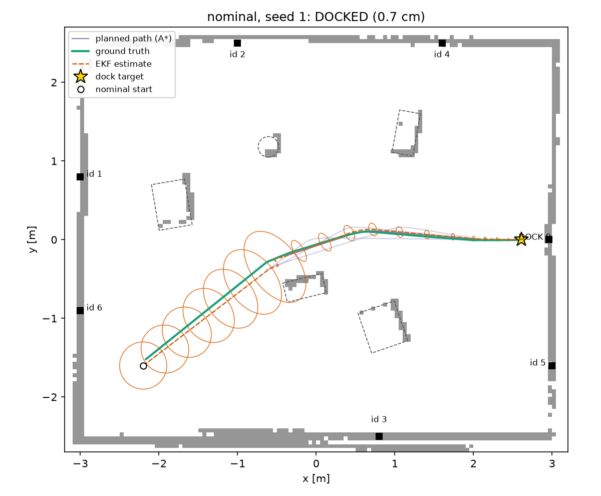
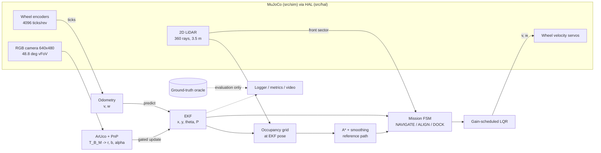
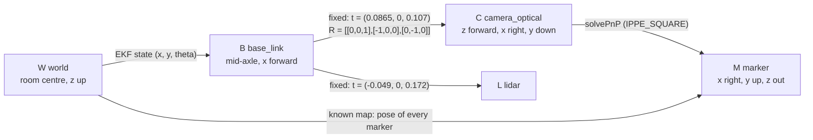
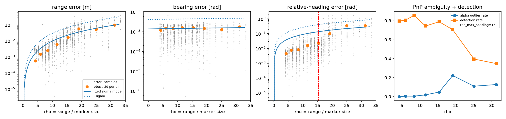
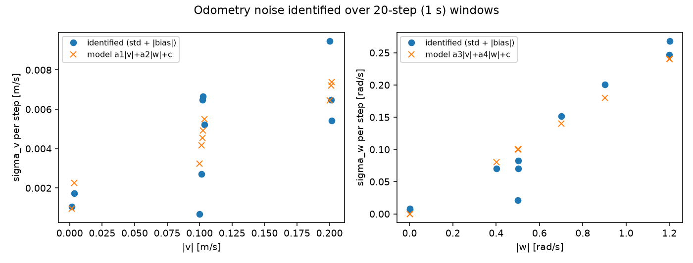
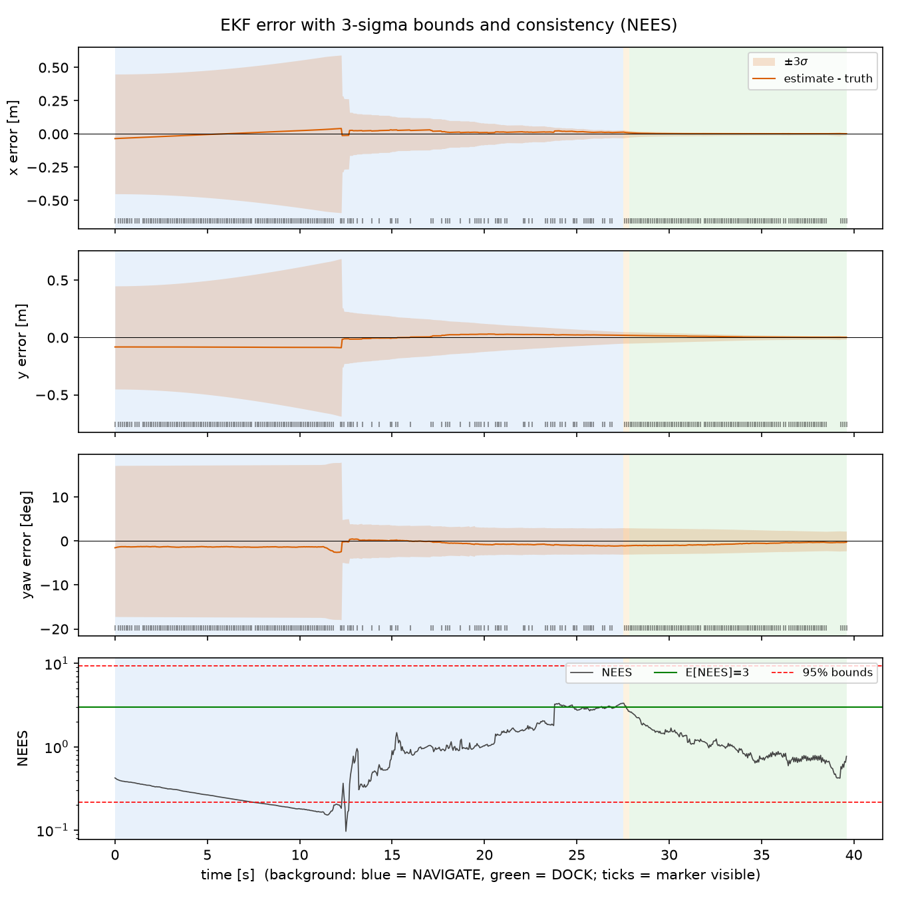
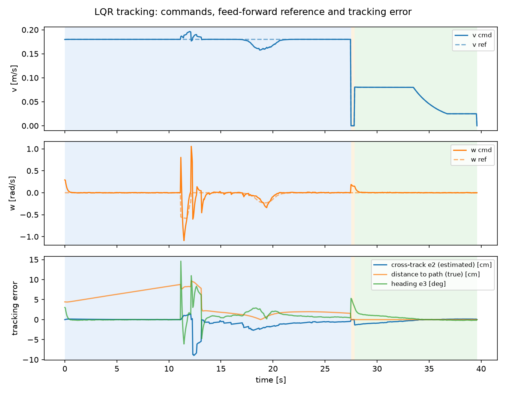
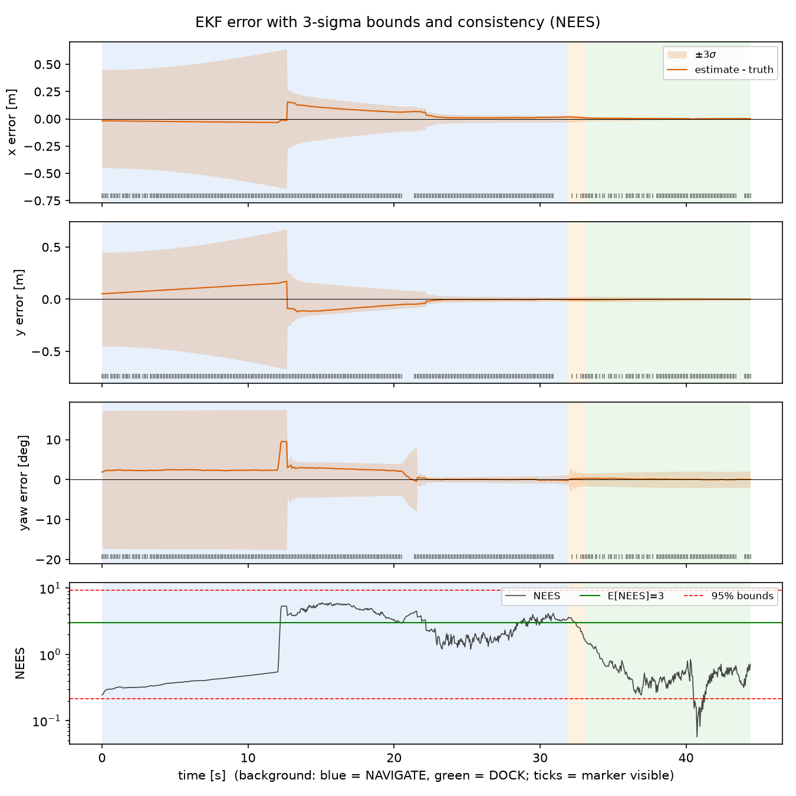

# G82 — Visual docking of a TurtleBot3 with an EKF and LQR (Track A)

**41014 Sensors and Control for Mechatronic Systems, Integrated Project, Spring 2026, Group 82**

> TurtleBot3 Waffle Pi in **MuJoCo** maps a room with obstacles using its **2D LiDAR**, plans with **A\***,
> tracks the path with a **gain-scheduled LQR**, and docks to an **ArUco-marked charging station**.
> All decisions use the pose from an **EKF** that fuses **wheel-encoder odometry** with **range, bearing and
> relative heading** to ArUco landmarks. Ground truth is used for evaluation only.

| Demo video (5 min) | Track | Platform |
|---|---|---|
| **TODO: link** | A, mobile robot visual waypoint navigation | MuJoCo 3, TurtleBot3 Waffle Pi (ROBOTIS menagerie) |



---

## 1. Quick start

```bash
git clone https://github.com/ramganeshsamala/G82 && cd G82
python -m venv .venv && source .venv/bin/activate        # Windows: .venv\Scripts\activate
pip install -r requirements.txt

python main.py                         # full pipeline, nominal scenario -> results/nominal_seed1_ekf/
python main.py --viewer                # same, with the live MuJoCo viewer
python main.py --scenario push --record   # disturbed trial + demo video (results/.../demo.mp4)
```

Each run writes `metrics.json`, `log.npz`, `map.png`, `estimation.png` and `control.png` (plus `demo.mp4` with `--record`).
Headless Linux uses OSMesa software rendering (`sudo apt install libosmesa6`); macOS and Windows use the default GLFW backend.

**Reproduce every number on this page** (about 1 h on a laptop, mostly the Monte-Carlo runs):

```bash
python scripts/calibrate_camera.py      # B: checkerboard calibration -> config/camera_calibration.json
python scripts/characterise_noise.py    # B/C: identify R (camera) and Q (odometry) -> config/noise_params.json
python -m src.analysis.model_analysis   # A: controllability / observability / LQR poles
python scripts/run_trials.py --scenarios nominal noisy slip push occlusion stress odom_only --seeds 10 --name robustness
python scripts/run_trials.py --scenarios nominal --seeds 6 --sweep ekf.r_scale=1,10,50,200 --name r_sweep
python scripts/run_trials.py --scenarios nominal --seeds 6 --sweep "lqr.u_max=(0.05,0.3),(0.1,0.6),(0.2,1.2)" --name lqr_sweep
python scripts/run_trials.py --scenarios nominal stress --seeds 10 --estimators ekf ukf --name ekf_vs_ukf
python -m pytest -q                     # unit tests, including "no ground truth in decision code"
```

Scenarios (`src/config.py`): `nominal`, `noisy` (3x sensor noise), `slip` (wrong wheel radii and base in odometry),
`push` (25 N lateral shove for 0.25 s at t = 12 s), `occlusion` (camera blacked out 5 to 15 s), `stress` (all of the above
plus one step of command latency), `odom_only` (camera disabled, as an ablation).
Every seed randomises the obstacle layout and the true start pose (the robot only knows the nominal start).

---

## 2. System overview



Rates: control, odometry and EKF predict at 20 Hz; camera and LiDAR at 10 Hz; physics at 500 Hz.
The controller, planner and estimator only see the `RobotInterface` (`src/hal/interface.py`), which has no
"true pose" method. Moving to the real robot means replacing `src/sim/mujoco_robot.py` with a ROS 2 driver that
implements the same five methods (hardware abstraction layer, as in lecture 10).

### Frames



Measurement chain: pixels → `solvePnP` gives `T_C_M` → `T_B_M = T_B_C · T_C_M` → `z = [‖p_xy‖, atan2(p_y, p_x), atan2(n_y, n_x)]`,
where `p` is the marker centre and `n` the marker normal (its z axis), both in B.
The EKF predicts the same quantities from `(x, y, θ)` and the marker's map pose `T_W_M`.
MuJoCo's camera frame (x right, y up, z backwards) is never used downstream. Using it instead of the optical frame
is the classic bug, and `scripts/calibrate_camera.py` checks `T_B_C` numerically (section 4).

---

## 3. Modelling (A)

**Platform model.** Differential drive, wheel radius r = 0.033 m and wheel separation L = 0.288 m (taken from the MJCF).

* Inputs: `u = [v, ω]`, with `v = r(ω_R + ω_L)/2` and `ω = r(ω_R − ω_L)/L`.
* State: `x = [x, y, θ]ᵀ`, with `ẋ = v cos θ`, `ẏ = v sin θ`, `θ̇ = ω`.

The estimator uses the mid-point discretisation, with Jacobians F and G in `src/estimation/ekf.py`.

**Assumptions:**

* No lateral slip (non-holonomic).
* Flat floor, so the model is planar (2D).
* Wheel-speed dynamics are much faster than the 20 Hz loop, so v and ω are treated as inputs.
* Actuator saturation is handled by preserving curvature (`MujocoTurtlebot.send_velocity`).

The physics deliberately violate the no-slip assumption: there is 3 to 5 % slip in arcs, which odometry cannot see.

**Changes to the ROBOTIS model**, all marked `G82` in the XML:

* **Velocity servo gain raised.** The stock kv = 0.1 tracked only about 50 % of the commanded wheel speed.
* **Base collision replaced by a box.** The stock mesh hull dragged on the floor.
* **Wheels made thin ellipsoids instead of cylinders.** A flat cylinder touches the floor at both rim edges and scrubbed about 20 % of the yaw rate in arcs, found in the odometry identification below.

**Controllability** (`python -m src.analysis.model_analysis`, full output in `docs/model_analysis.md`):

| model | rank C | controllable |
|---|---|---|
| unicycle linearised at rest (A = 0) | 2 | **no**: no instantaneous sideways motion |
| tracking error, v_r = 0, ω_r = 0 | 2 | **no** |
| tracking error, v_r ≠ 0 or ω_r ≠ 0 | 3 | yes |

The LQR is therefore designed on the **tracking-error model** about the moving reference, and its gain is scheduled
on `(v_r, ω_r)` with |v_r| ≥ 0.03 m/s (section 6). Pure rotation (`ALIGN` states) uses a separate heading loop.

**Observability** (local observability matrix `O = [H; HF; HF²]`, evaluated numerically):

| sensors | rank O | unobservable direction |
|---|---|---|
| odometry only | 0 | everything: drift is unbounded |
| 1 marker, range + bearing, static **or moving** | 2 | rotation of the pose about the marker |
| 1 marker, range + bearing + relative heading α | 3 | none |
| 2 markers, range + bearing | 3 | none |

A key point: **motion does not fix the single-landmark case**. Odometry is body-frame, so rotating the whole pose
about the landmark changes no future measurement. That is why the camera measurement includes the PnP relative
heading α (when the marker is large enough, see section 4), and why the room has six wall landmarks besides the dock.

---

## 4. Sensing (B)

**Camera calibration** (`scripts/calibrate_camera.py`): a 9×6 checkerboard (25 mm squares) is placed at 60 random
poses in front of the robot camera, rendered with the image-noise model, then put through `cv2.calibrateCamera`
(k3 and tangential terms fixed to zero).

<!-- AUTO:CALIBRATION_TABLE -->
| parameter | calibrated | analytic (MuJoCo fovy=48.8 deg) | difference |
|---|---|---|---|
| fx [px] | 527.47 | 529.08 | -0.30 % |
| fy [px] | 527.02 | 529.08 | -0.39 % |
| cx [px] | 318.98 | 319.50 | -0.52 px |
| cy [px] | 241.07 | 239.50 | +1.57 px |
| k1, k2 | -0.0228, +0.0488 | 0, 0 (ideal pinhole) | |
<!-- /AUTO:CALIBRATION_TABLE -->

Fixing the tangential terms mattered: with them free, cx drifted by 6 px, a 0.7° bearing bias, because they trade off against the principal point.
The **extrinsic `T_B_C` check** reprojects the true board pose through `T_B_C` and compares it with PnP. The board centre agrees
to <!-- AUTO:EXTRINSIC_ERR -->2.77 mm (max 4.41 mm, 60 views)<!-- /AUTO:EXTRINSIC_ERR --> on average, which confirms the frame chain.

**Sensor models and noise** (MuJoCo is noise-free, so all noise is injected in `src/sim/mujoco_robot.py`):

| sensor | model |
|---|---|
| encoders | true wheel angle + random-walk slip (σ = 0.002 rad/step while moving), quantised to 4096 ticks/rev |
| camera | render → 3×3 Gaussian blur → N(0, 4) grey-level noise; optional blackout (occlusion) |
| LiDAR | `mj_multiRay` from the scan plane, N(0, 1 cm) range noise, 2 % dropouts, 0.12 to 3.5 m |

**Noise identification** (`scripts/characterise_noise.py`). This is an offline experiment that uses ground truth, as you would
use motion capture on the real robot.

* **Camera R.** The robot is placed at about 800 poses relative to the 12 cm dock marker and a 20 cm wall marker:
  * range 0.3 to 4 m
  * viewing angle ±60°
  * image offset ±15°

  The errors of `[r, b, α]` are binned by the marker's **apparent size ρ = range / marker size**, and a robust (MAD) σ is fitted per bin.



* Range error grows with ρ², while bearing error is flat at about <!-- AUTO:SIGMA_B -->0.0014<!-- /AUTO:SIGMA_B --> rad (sub-pixel).
* α (planar-PnP orientation) has an **ambiguity**: above ρ ≈ <!-- AUTO:RHO_MAX -->15.3<!-- /AUTO:RHO_MAX -->, more than 5 % of α estimates are flipped by tens of degrees.
  The EKF therefore uses α only for ρ < <!-- AUTO:RHO_MAX -->15.3<!-- /AUTO:RHO_MAX -->.
* **Odometry Q.** The robot drives 19 constant (v, ω) commands, and odometry is compared with truth over 1 s windows.
  Per-step differences of MuJoCo's pose contain contact jitter that averages out, so they overestimate the noise.
  The error is almost entirely systematic slip (3 to 5 % in arcs, about 1 % straight), which gives σ_v = <!-- AUTO:A1 -->0.032<!-- /AUTO:A1 -->|v| and σ_ω = <!-- AUTO:A4 -->0.200<!-- /AUTO:A4 -->|ω|.



**Noise handling in the pipeline:**

* Gaussian-blur-robust ArUco detection with sub-pixel corners.
* Detections are rejected when the PnP reprojection error exceeds 2 px or the marker normal points away from the robot.
* A χ² innovation gate is applied in the EKF.
* LiDAR is fused into a log-odds grid, so single noisy returns do not create obstacles.

---

## 5. Estimation (C)

EKF in `src/estimation/ekf.py`. A UKF with the same models is in `src/estimation/ukf.py`.

| item | design | value / source |
|---|---|---|
| state | `[x, y, θ]` in W | |
| predict | odometry `(v, ω)` at 20 Hz, mid-point model | |
| Q | input-noise model `M = diag((a1|v|+a2|ω|+c_v)², (a3|v|+a4|ω|+c_ω)²)`, `Q = G M Gᵀ` | identified: <!-- AUTO:Q_PARAMS -->a1=0.0323, a2=0.00188, a3=0, a4=0.2, v_floor=0.001, w_floor=0.002<!-- /AUTO:Q_PARAMS --> |
| measurement | `z = [r, b, α]` per visible marker (α only if ρ < <!-- AUTO:RHO_MAX -->15.3<!-- /AUTO:RHO_MAX -->) | known marker map |
| R | `diag(σ_r(ρ)², σ_b(ρ)², σ_α(ρ)²) · r_scale` | identified models, r_scale = 10 (see below) |
| gating | NIS χ² test, p = 0.997 (2 or 3 dof) | |
| update | Joseph form | |
| lock-out recovery | after 8 consecutive gate rejections, inflate P by diag(0.1², 0.1², 0.08²) | |
| initialisation | nominal start pose, P₀ = diag(0.15², 0.15², 0.10²) | true start is nominal + N(0, (0.1, 0.1, 0.08)) |

**Choosing R: consistency vs responsiveness.** The R identified from *static* images is too optimistic once the robot moves,
because body rocking, slip and timing are not in that experiment. The R scale was therefore chosen with a sweep on paired seeds
(`python scripts/run_trials.py --sweep ekf.r_scale=1,10,50`):

<!-- AUTO:R_SWEEP_TABLE -->
| condition | scenario | estimator | n | success_rate | dock_pos_err | dock_yaw_err_deg | est_rmse_xy | nees_mean | track_e2_rmse | cross_track_rmse | effort | duration |
|---|---|---|---|---|---|---|---|---|---|---|---|---|
| ekf.r_scale=1 | nominal | ekf | 10 | 100 % | 2.02 ± 0.98 cm | 2.06 ± 1.24 | 8.60 ± 4.18 cm | 3.78 ± 1.56 | 3.01 ± 1.75 cm | 7.95 ± 5.25 cm | 0.38 ± 0.03 | 40.69 ± 3.64 |
| ekf.r_scale=10 | nominal | ekf | 10 | 100 % | 2.04 ± 1.01 cm | 2.16 ± 1.31 | 8.71 ± 4.04 cm | 1.93 ± 1.04 | 2.73 ± 1.82 cm | 7.89 ± 5.34 cm | 0.38 ± 0.02 | 40.72 ± 3.53 |
| ekf.r_scale=50 | nominal | ekf | 10 | 100 % | 2.08 ± 0.97 cm | 2.24 ± 1.26 | 8.86 ± 3.96 cm | 1.58 ± 0.72 | 2.56 ± 1.86 cm | 7.92 ± 5.36 cm | 0.38 ± 0.02 | 41.03 ± 4.02 |
<!-- /AUTO:R_SWEEP_TABLE -->

* **r_scale = 1:** the filter is overconfident (mean NEES ≈ 5 against the ideal 3 for 3 dof).
  Overconfidence is what caused the gate lock-out failure (section 7).
* **r_scale = 50:** under-confident, with no accuracy gain.
* **Chosen:** r_scale = 10, which is slightly conservative (NEES < 3). Docking error and estimation RMSE barely change across
  the sweep, so the choice trades only covariance realism, not accuracy. Log-interpolating the sweep, r_scale ≈ 3 would give NEES ≈ 3.
  We stayed conservative because a too-small R fails catastrophically through the gate, while a too-large R only costs a little responsiveness.
* *Caveat:* the mean NEES includes the start of each run, when P₀ is deliberately generous, which pulls it below 3.



*Estimate minus truth with ±3σ bounds. Ticks show when a marker is visible. The covariance grows at the start because
no marker is within 3.5 m of the start pose, then collapses at the first landmark update.*

---

## 6. Control (D)

**Tracking error in the robot frame:**

* `e₁ = cos θ (x_r − x) + sin θ (y_r − y)` (along-track)
* `e₂ = −sin θ (x_r − x) + cos θ (y_r − y)` (cross-track)
* `e₃ = θ_r − θ` (heading)

The inputs are `u₁ = v_r cos e₃ − v` and `u₂ = ω_r − ω`. Linearised:

`ė = [[0, ω_r, 0], [−ω_r, 0, v_r], [0, 0, 0]] e + [[1, 0], [0, 0], [0, 1]] u`

* **Discretisation:** at 20 Hz. The DARE is solved every step for the current `(v_r, ω_r)`, which gives a gain-scheduled LQR.
* **Command:** `v = v_r cos e₃ + K₁e` and `ω = ω_r + K₂e`. The feed-forward `(v_r, ω_r = v_r κ)` comes from the smoothed A\* path.
* **Weights (Bryson's rule):**
  * Errors: max along-track 0.10 m, cross-track 0.05 m, heading 0.10 rad, so Q = diag(100, 400, 100).
  * Inputs: max corrections 0.10 m/s and 0.6 rad/s, so R = diag(100, 2.8).
  * Cross-track gets the largest weight because it is what collides with obstacles.
* **Speed profile:** `v_r(s) = min(0.18, √(a_lat/|κ|), √(2 a_long (s_end − s)))`. Docking speed is proportional to the remaining distance, from 0.08 m/s down to 0.025 m/s.

<!-- AUTO:POLES_TABLE -->
| v_r | w_r | K (2x3) | closed-loop eigenvalue magnitude (discrete) | continuous-equivalent poles [1/s] |
|---|---|---|---|---|
| 0.03 | 0.0 | [[ 0.98  0.    0.  ] [ 0.   10.32  5.23]] | 0.951, 0.742, 0.997 | -1.00+0.00j, -5.98+0.00j, -0.06+0.00j |
| 0.08 | 0.0 | [[ 0.98  0.    0.  ] [ 0.   10.29  5.32]] | 0.951, 0.742, 0.992 | -1.00+0.00j, -5.98+0.00j, -0.16+0.00j |
| 0.18 | 0.0 | [[ 0.98 -0.   -0.  ] [-0.   10.24  5.52]] | 0.951, 0.742, 0.982 | -1.00+0.00j, -5.97+0.00j, -0.36+0.00j |
| 0.18 | 0.5 | [[ 1.49 -1.24 -0.05] [-1.38  4.95  5.34]] | 0.742, 0.959, 0.959 | -5.97+0.00j, -0.84+0.63j, -0.84-0.63j |
<!-- /AUTO:POLES_TABLE -->

**What limits the gains:**

* The slowest closed-loop mode is the cross-track/heading coupling. Its pole scales with v_r, because cross-track error
  can only be removed by driving with a heading offset. This is the controllability result above, seen in the poles, and it is why the gain uses v_r ≥ 0.03 m/s.
* The ω limit of 1.82 rad/s saturates on replans, visible as spikes in the control plot.

**Control effort vs tracking error** (sweep of the Bryson input limits, paired seeds):

<!-- AUTO:LQR_SWEEP_TABLE -->
| condition | scenario | estimator | n | success_rate | dock_pos_err | dock_yaw_err_deg | est_rmse_xy | nees_mean | track_e2_rmse | cross_track_rmse | effort | duration |
|---|---|---|---|---|---|---|---|---|---|---|---|---|
| lqr.u_max=(0.05,0.3) | nominal | ekf | 10 | 100 % | 2.11 ± 1.06 cm | 2.23 ± 1.37 | 8.73 ± 4.04 cm | 1.96 ± 1.01 | 2.90 ± 1.91 cm | 7.95 ± 5.40 cm | 0.37 ± 0.02 | 41.13 ± 3.60 |
| lqr.u_max=(0.1,0.6) | nominal | ekf | 10 | 100 % | 2.04 ± 1.01 cm | 2.16 ± 1.31 | 8.71 ± 4.04 cm | 1.93 ± 1.04 | 2.73 ± 1.82 cm | 7.89 ± 5.34 cm | 0.38 ± 0.02 | 40.72 ± 3.53 |
| lqr.u_max=(0.2,1.2) | nominal | ekf | 10 | 100 % | 1.99 ± 0.97 cm | 2.08 ± 1.28 | 8.85 ± 4.17 cm | 1.92 ± 0.86 | 2.82 ± 1.87 cm | 7.95 ± 5.48 cm | 0.39 ± 0.03 | 40.48 ± 3.62 |
<!-- /AUTO:LQR_SWEEP_TABLE -->

The trade-off is weak in this task:

* Most of the command is feed-forward (v_r, ω_r = v_r κ), so the feedback term contributes little to effort.
* The dominant tracking error early in each run is *estimation* error before the first marker is seen, which no controller gain can remove.
  It shows in the true cross-track error but not in the controller's own error e₂.
* Across a 16× range of input limits, docking error is unchanged.
* The cheapest setting gives slightly larger controller cross-track error (e₂ about 5.0 vs 4.7 cm).
* The most aggressive setting uses slightly more effort (0.43 vs 0.40).
* The middle setting is kept: it sits at the knee of these trade-offs.

**Docking accuracy is control-limited, not estimation-limited:**

* At the dock, the estimate is within a few millimetres and a fraction of a degree of the truth (2 mm in `nominal`, seed 1).
* The residual of about 2 cm and 2° comes from the slow cross-track mode at docking speed (0.025 to 0.08 m/s), combined with the
  up to 12 cm lateral offset allowed at the pre-dock pose.
* Proposed fix: a tighter pre-dock tolerance with a longer straight approach, or a docking-specific Q with more cross-track weight.



*Commands vs feed-forward reference, and tracking error. The true distance to the path grows at the start because the robot
follows its estimate, which is wrong until the first landmark is seen.*

---

## 7. Integration and robustness (E)

**Mission:** NAVIGATE → (ALIGN_PATH) → ALIGN_DOCK → DOCK → DOCKED.

* **NAVIGATE:** A\* is planned on the LiDAR occupancy grid, which is built at the EKF pose. It replans when the path becomes
  blocked, when the estimate deviates more than 0.35 m, or when the path ends.
* **LiDAR safety layer:** blocks forward motion if any return in ±35° is within 12 cm of the robot front.
* **ALIGN_DOCK:** rotates to face the dock at the pre-dock pose, 0.85 m from the marker.
* **DOCK:** a straight-line LQR approach to 0.35 m from the marker, where the robot front stops on the yellow charging pad.
* **Success** (ground truth): final position within 5 cm and yaw within 10° of the dock pose.

**Monte-Carlo results:** <!-- AUTO:N_SEEDS -->10<!-- /AUTO:N_SEEDS --> random worlds per scenario. Each seed randomises the obstacles and the true start, and
seeds are paired across scenarios. Mean ± std, from `results/trials/robustness/summary.md`.

<!-- AUTO:ROBUSTNESS_TABLE -->
| condition | scenario | estimator | n | success_rate | dock_pos_err | dock_yaw_err_deg | est_rmse_xy | nees_mean | track_e2_rmse | cross_track_rmse | effort | duration |
|---|---|---|---|---|---|---|---|---|---|---|---|---|
| default | noisy | ekf | 10 | 100 % | 2.03 ± 1.01 cm | 2.21 ± 1.36 | 9.00 ± 4.39 cm | 2.24 ± 1.10 | 2.78 ± 1.98 cm | 8.01 ± 5.93 cm | 0.38 ± 0.03 | 41.27 ± 3.67 |
| default | nominal | ekf | 10 | 100 % | 2.04 ± 1.01 cm | 2.16 ± 1.31 | 8.71 ± 4.04 cm | 1.93 ± 1.04 | 2.73 ± 1.82 cm | 7.89 ± 5.34 cm | 0.38 ± 0.02 | 40.72 ± 3.53 |
| default | occlusion | ekf | 10 | 100 % | 1.96 ± 1.00 cm | 1.98 ± 1.31 | 10.16 ± 5.31 cm | 1.82 ± 0.78 | 3.24 ± 2.64 cm | 9.56 ± 6.83 cm | 0.38 ± 0.03 | 40.93 ± 3.92 |
| default | odom_only | ekf | 10 | 0 % | 38.47 ± 28.41 cm | 4.90 ± 3.77 | 29.80 ± 19.21 cm | 2.16 ± 1.45 | 0.47 ± 0.29 cm | 21.73 ± 15.13 cm | 0.37 ± 0.03 | 40.54 ± 4.27 |
| default | push | ekf | 10 | 100 % | 1.93 ± 1.05 cm | 1.99 ± 1.39 | 8.84 ± 3.75 cm | 11.40 ± 8.76 | 3.52 ± 1.70 cm | 8.18 ± 4.90 cm | 0.39 ± 0.03 | 41.26 ± 3.76 |
| default | slip | ekf | 10 | 90 % | 2.63 ± 1.56 cm | 2.81 ± 1.76 | 11.01 ± 4.26 cm | 25.88 ± 10.83 | 5.04 ± 1.36 cm | 11.21 ± 4.78 cm | 0.41 ± 0.01 | 41.97 ± 6.40 |
| default | stress | ekf | 10 | 100 % | 2.63 ± 1.25 cm | 2.69 ± 1.50 | 9.85 ± 3.40 cm | 12.54 ± 7.40 | 4.13 ± 1.58 cm | 8.91 ± 4.37 cm | 0.41 ± 0.03 | 40.20 ± 4.52 |
<!-- /AUTO:ROBUSTNESS_TABLE -->

**Reading the table:**

* **Columns:**
  * `dock_pos_err` and `dock_yaw_err_deg` are measured against ground truth.
  * `est_rmse_xy` is the EKF error over the whole run, dominated by the first seconds before any marker is in range.
  * `track_e2_rmse` is the controller's own cross-track error relative to its estimate.
  * `cross_track_rmse` is the *true* distance to the planned path, so it includes estimation error.
* **`odom_only` is the observability result in practice.** The controller tracks its estimate almost perfectly (e₂ RMS < 1 cm),
  yet the robot misses the dock by about 40 cm, because without exteroception the estimate drifts.
  Good control on a bad estimate is still a failure, which is why the brief forbids ground truth in the loop.
* **`occlusion`:** 10 s of camera blackout raises the estimation RMSE, but the run still docks. Odometry holds the pose to a few
  centimetres over 10 s, and the covariance grows honestly (NEES stays near 2).
* **`push`:** succeeds, but the NEES spikes: the shove is not in the process model.
* **`slip` and `stress`:** high NEES (inconsistent) despite successful docking. A biased odometry model makes the filter
  overconfident between marker sightings (see failure 6).


**Failures and diagnosis** (what went wrong during development and how each was traced):

1. **Filter lock-out after a bad PnP heading (estimator).**
   * *Symptom:* in an early `push` trial, the dock was missed by 30 cm. NEES jumped to about 30 and stayed there, while markers were visible the whole time.
   * *Cause:* a dock-marker reading at 2.3 m (ρ ≈ 19) had an α error of −7° (planar-PnP ambiguity). The filter accepted it with
     σ_α = 0.05 rad and became confidently wrong, and the χ² gate then rejected every correct measurement.
   * *Fix:*
     * σ_α now grows with ρ.
     * α is used only for ρ < <!-- AUTO:RHO_MAX -->15.3<!-- /AUTO:RHO_MAX -->.
     * Covariance is inflated after 8 consecutive rejections.
   * *Result:* the same trial now docks within 1.4 cm.
2. **Odometry 20 % yaw error in arcs (model / sim).** Found by the odometry identification: flat cylinder wheels scrub at
   two contact points. Thin ellipsoid wheels (single contact) reduced this to 3 to 5 %, which matches the real robot's typical slip.
3. **Velocity servo too soft (model).** With the stock kv = 0.1, the wheels reached only about 50 % of the commanded speed, so the
   LQR feed-forward was meaningless. kv was raised to 1.5, representing the Dynamixel's internal velocity loop.
4. **Overconfident R from static characterisation (estimator).** NEES was about 10. Fixed with the R sweep above.
5. **Sawtooth in the speed command (control).**
   * *Symptom:* the control plot showed v oscillating ±0.02 m/s at about 2 Hz.
   * *Cause:* the reference was the nearest path *vertex* (5 cm spacing), so the along-track error jumped by up to 5 cm and the LQR chased it.
   * *Fix:* continuous projection onto the path segment with interpolated (x, y, θ, v, κ).
6. **`slip` scenario is inconsistent (open issue).** The robot still docks, but NEES is well above 3, because a wrong wheel
   radius is a *bias* and the EKF models only zero-mean noise. A justified extension is to augment the state with odometry scale
   factors (r_L, r_R, L) and estimate them online. Landmarks make them observable while turning.

**Limits of the approach** (what the results do and do not support):

* The marker map is assumed known and exact. Map errors appear directly as pose bias.
* The pose is planar (3 DOF), so body pitch while accelerating appears as range and bearing noise. That is part of why R had to be inflated.
* Simulated camera images have no motion blur, rolling shutter or lighting change. Real detection ranges will be shorter, especially for the 12 cm dock marker.
* The occupancy grid is built from the estimated pose, so large estimation errors corrupt the map. There is no loop closure (this is not SLAM).
* Success rates come from <!-- AUTO:N_SEEDS -->10<!-- /AUTO:N_SEEDS --> seeds per scenario, so they carry roughly ±<!-- AUTO:CI -->31<!-- /AUTO:CI --> % binomial uncertainty.

---

## 8. Beyond the brief (HD evidence)

* **Data-driven noise models.** R as a function of apparent marker size, with an identified PnP-ambiguity threshold; Q identified from windowed odometry error.
* **Estimator comparison.** UKF vs EKF on paired seeds (`--estimators ekf ukf`):

<!-- AUTO:UKF_TABLE -->
| condition | scenario | estimator | n | success_rate | dock_pos_err | dock_yaw_err_deg | est_rmse_xy | nees_mean | track_e2_rmse | cross_track_rmse | effort | duration |
|---|---|---|---|---|---|---|---|---|---|---|---|---|
| default | nominal | ekf | 10 | 100 % | 2.04 ± 1.01 cm | 2.16 ± 1.31 | 8.71 ± 4.04 cm | 1.93 ± 1.04 | 2.73 ± 1.82 cm | 7.89 ± 5.34 cm | 0.38 ± 0.02 | 40.72 ± 3.53 |
| default | nominal | ukf | 10 | 100 % | 1.97 ± 0.94 cm | 2.07 ± 1.20 | 8.64 ± 4.19 cm | 1.80 ± 0.80 | 2.70 ± 1.85 cm | 7.88 ± 5.40 cm | 0.38 ± 0.02 | 41.02 ± 3.54 |
| default | stress | ekf | 10 | 100 % | 2.63 ± 1.25 cm | 2.69 ± 1.50 | 9.85 ± 3.40 cm | 12.54 ± 7.40 | 4.13 ± 1.58 cm | 8.91 ± 4.37 cm | 0.41 ± 0.03 | 40.20 ± 4.52 |
| default | stress | ukf | 10 | 90 % | 11.13 ± 26.06 cm | 4.61 ± 6.23 | 13.83 ± 12.72 cm | 17.00 ± 10.20 | 4.30 ± 1.65 cm | 10.77 ± 7.24 cm | 0.40 ± 0.03 | 42.02 ± 5.62 |
<!-- /AUTO:UKF_TABLE -->

  The UKF gives no measurable benefit here. At 20 Hz the motion model is nearly linear over one step, and the measurement
  nonlinearity matters only very close to a marker, where the measurements are most accurate anyway. Both filters share the
  same weakness, the unmodelled odometry *bias* in `stress`/`slip` (high NEES). The fix for that is a better model (bias states),
  not a better linearisation.



*`push` scenario: a 25 N lateral shove at t = 12 s, invisible to odometry, makes the error jump by about 15 cm and 8°.
In this seed the shove happens before any marker is in range, so P is still large and the jump stays inside the 3σ envelope.
The first landmark updates pull the estimate back within a few seconds. When P is small, the same shove produces innovations
that fail the gate, which is why the gate-recovery logic exists (failure 1).*

* **Robustness study** across 7 scenarios, including disturbances the brief did not ask for (push, occlusion, latency, odometry miscalibration) and an odometry-only ablation.
* **Hardware readiness.** Everything above the HAL is simulator-agnostic.
* **TODO (team):** real TurtleBot3 run and a sim-vs-real comparison, if we pass the Week 10 induction.

---

## 9. Repository layout

```
main.py                     one-command demo (scenario / seed / video / viewer)
assets/tb3/                 TurtleBot3 Waffle Pi MJCF + meshes (ROBOTIS, Apache-2.0) with G82 sensor additions
src/config.py               every parameter, scenario presets
src/hal/interface.py        hardware abstraction (no ground truth)
src/sim/                    world generator (room, obstacles, ArUco markers), MuJoCo robot, ground-truth oracle
src/perception/             camera model + extrinsics, ArUco + PnP measurements
src/estimation/             odometry, EKF, UKF
src/planning/               LiDAR occupancy grid, A*, path smoothing / reference
src/control/                LQR tracker, mission state machine + LiDAR safety layer
src/analysis/               controllability / observability / poles
src/evaluation/             logger + metrics (only user of ground truth), plots, video
scripts/                    calibration, noise identification, Monte-Carlo trials
tests/                      unit tests incl. the ground-truth-leak check
docs/figures/               figures used on this page
```

**Ground truth.** It is read only by `src/sim/ground_truth.py`, which `main.py`/`src/runner.py` call *after* the command for
the step is computed, plus the offline calibration scripts. `tests/test_pipeline.py::test_no_ground_truth_in_decision_code`
fails if any module in `estimation/`, `planning/`, `control/` or `perception/` references it or reads simulator state.

---

## 10. Team and contributions

| member | student ID | main contribution | also responsible for |
|---|---|---|---|
| TODO | | | |
| TODO | | | |
| TODO | | | |

## 11. Generative AI declaration

**TODO (team: edit so it is accurate).** We used Anthropic's Claude to help with:

* scaffolding the repository structure
* drafting code for the simulator HAL, EKF/UKF, LQR, planner, evaluation scripts and tests
* drafting this page

Every design choice, parameter and result on this page was reviewed, run and checked by the team. The numbers are produced by
the scripts in this repository, and each member can explain the pipeline (viva).

## 12. Acknowledgements

* TurtleBot3 Waffle Pi model and meshes: [ROBOTIS robotis_mujoco_menagerie](https://github.com/ROBOTIS-GIT/robotis_mujoco_menagerie), Apache-2.0 (`assets/tb3/LICENSE`).
* The A\* planner structure was inspired by `path_planning.py` in [Smart_Factory](https://github.com/Prethivi1608/Smart_Factory) (Prethiviraj, ROS 2). It was re-implemented here.
* 41014 weekly tutorial material (EKF, LQR); MuJoCo; OpenCV ArUco.
* References:
  * Thrun, Burgard and Fox, *Probabilistic Robotics* (velocity motion model, EKF localisation).
  * Kanayama et al. 1990 (tracking-error model).
  * Wan and van der Merwe 2000 (UKF).
